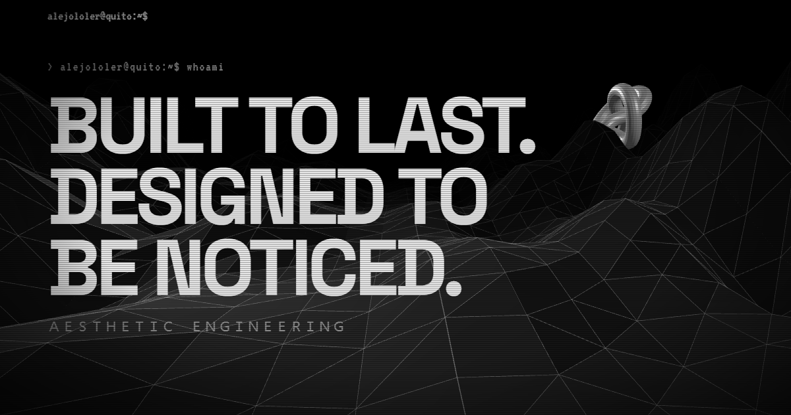

<a href="https://alejololer.is-a.dev">
  
</a>

<p align="center">
  <a href="https://alejololer.is-a.dev">
     whoami: Carlos Alejandro Alemán, Software Engineer">
  </a>
</p>

### `> cat about.txt`


**I turn days into hours.** Mostly with LLMs, occasionally with coffee.

```
name ...... Carlos Alejandro Alemán
role ...... Software Engineer @ Upstart 13
stack ..... Django · Next.js · Astro · LLMs · Azure
based ..... Quito, Ecuador
status .... just chillin'
```

- B.Eng. Software Engineering, Escuela Politécnica Nacional
- Microsoft Certified: Azure Administrator Associate (AZ-104)
- I also design and ship websites for small businesses that actually get found.
- **[alejololer.is-a.dev](https://alejololer.is-a.dev)** has the full story and my CV.

### `> cat stack`


![Azure](https://img.shields.io/badge/Azure-000000?style=for-the-badge&logo=data%3Aimage%2Fsvg%2Bxml%3Bbase64%2CPHN2ZyB2aWV3Qm94PSIwIDAgMTI4IDEyOCIgeG1sbnM9Imh0dHA6Ly93d3cudzMub3JnLzIwMDAvc3ZnIj48cGF0aCBkPSJNNDMuOTgzIDQuNjUzYTUuOTExIDUuOTExIDAgMDE1LjYgNC4wMjJsMzUuOTEgMTA2LjM5NmE1LjkxMSA1LjkxMSAwIDAxLTUuNjAzIDcuODAyaDQxLjM4YTUuOTE3IDUuOTE3IDAgMDA0LjgtMi40NjUgNS45MDkgNS45MDkgMCAwMC43OTgtNS4zNEw5MC45NjEgOC42NzJhNS45MSA1LjkxIDAgMDAtNS42MDItNC4wMjJ6bS0xLjMzNi40NzhhNS45MiA1LjkyIDAgMDAtNS42MSA0LjAyOUwxLjEzMiAxMTUuNTVhNS45MSA1LjkxIDAgMDA1LjYgNy44aDI4Ljg5M2MxLjIzOSAwIDIuNDQ2LS40MSAzLjQ1Mi0xLjExM2E1LjkyMyA1LjkyMyAwIDAwMi4xNTctMi45MTZsNy4wMTktMjAuNzEtMTMuNDExLTEyLjg1N2MtLjI0Ni0uMjczLTEuMzUzLTIuMjc0LS4zNjktNC4wMDIgMS4xMDgtMS42NTkgMi45NTUtMS42NTkgMi45NTUtMS42NTloMTcuMjg1bDkuMDc0LTI2LjE0NUw0OC4yNzQgOC4zMjFjLS4wNDItLjIwNS0uOTE0LTEuMzY1LTIuMjgxLTIuMjgtMS4zNy0uOTE1LTMuMzQ1LS45MDktMy4zNDUtLjkwOXptLTQuODggNzUuNzRhMi43MjQgMi43MjQgMCAwMC0xLjg2IDQuNzE4bDM3LjgzIDM1LjMxYzEuMTAxIDEuMDMgMi41MDIgMS42MzEgNC4wMDcgMS42MzEgMCAwIDEuMjgyLjA2OCAyLjA1NS0uMDMzIDEuODE3LS4yNzMgMy41MjUtMS43NjggNC4wOS0yLjM5IDEuNDU3LTEuOTM5Ljc5NC00Ljk1Ljc5NC00Ljk1bC0xMS40NS0zNC4yOHoiIGZpbGw9IiNmZmYiLz48L3N2Zz4K)


### `> ls ./shipped`

| | | |
|---|---|---|
| **[virtus.exe](https://virtusestudiojuridico.com)** | Law firm · Salcedo | Top 3 on Google for “abogados Salcedo”. |
| **[asia_motors.exe](https://asia-motors-eta.vercel.app)** | Vehicle importer · Ecuador | Catalog, EV savings calculator, test drives and quotes. |
| **[con_carino.exe](https://con-carino.vercel.app)** | Gift shop · Latacunga | Catalog + cart that sends the order to WhatsApp. |

### `> git log --stats`

<p align="center">
  
  
</p>

<p align="center">
  <a href="https://gitfut.com/Alejololer">
    
  </a>
</p>

### `> now-playing`

<p align="center">
  <a href="https://www.last.fm/user/Alejololer">
    
  </a>
</p>

### `> cat hobbies`

```
games ..... FPS and RPGs (headshots only)
music ..... audiophile, crisp sound or nothing
football .. goalkeeper, still dodging stray shots to the face
reading ... tech blogs and whatever ships next
```

### `> ./contact.sh`

[](https://alejololer.is-a.dev)
[](https://www.linkedin.com/in/alejoaleman)
[](mailto:acarlosaleman03@gmail.com)
[](https://alejololer.is-a.dev/cv.pdf)

<picture>
  <source media="(prefers-color-scheme: dark)" srcset="https://raw.githubusercontent.com/Alejololer/Alejololer/output/github-snake-dark.svg">
  
</picture>

<p align="center"><code>built in Quito by a goalkeeper who refuses to let bugs through_</code></p>
